<h1 align="center">A Comprehensive Survey on Video Retrieval-Augmented Generation: A System-Oriented Perspective</h1>

<p align="center">
  
  
  
  
</p>


This repository accompanies **A Comprehensive Survey on Video Retrieval-Augmented Generation: A System-Oriented Perspective**. It presents a system-oriented overview of **video knowledge organization, evidence acquisition, and retrieval-augmented generation**, along with a curated collection of research papers and evaluation resources.

Video RAG makes large-scale and long-form video content searchable and supports responses grounded in retrieved **visual, textual, acoustic, temporal, and structured evidence**.

<a id="quick-index"></a>

## Quick Index

- [Workflow](#workflow)
- [What Counts as Video RAG?](#what-counts-as-video-rag)
- [Evolution](#evolution)
- [Taxonomy and Key Design Choices](#taxonomy-and-key-design-choices)
- [Video Knowledge Indexing and Representation](#video-knowledge-indexing-and-representation)
- [Retrieval Strategies and Mechanisms](#retrieval-strategies-and-mechanisms)
  - [Retrieval Granularity](#retrieval-granularity)
  - [Retrieval Mechanism](#retrieval-mechanism)
- [Retrieval Augmentation and Generation](#retrieval-augmentation-and-generation)
  - [Multimodal Fusion](#multimodal-fusion)
  - [Integration Paradigms of Video RAG Systems](#integration-paradigms-of-video-rag-systems)
- [Benchmarks and Datasets](#benchmarks-and-datasets)
- [Evaluation](#evaluation)
- [Paper Collection](#paper-collection)
- [Applications](#applications)
- [Challenges and Future Directions](#challenges-and-future-directions)
- [Contributing and Citation](#contributing-and-citation)

---

## Workflow

The survey organizes Video RAG systems into three connected stages:

1. **Video knowledge indexing and representation** — prepare video corpora, extract and align multimodal content, construct retrievable knowledge bases, and build indices.
2. **Retrieval strategies and mechanisms** — interpret queries, select the retrieval target and temporal granularity, retrieve relevant evidence, and filter or rerank the results.
3. **Retrieval augmentation and generation** — fuse evidence across modalities and generate responses supported by retrieved video content.

The workflow below maps these stages to their constituent modules and associated methods.

<p align="center">
  <a href="imgC/Fig10_Workflow.png"></a>
</p>


---

## What Counts as Video RAG?

In this survey, a system is counted as Video RAG when:

1. Video content is transformed into a **retrievable knowledge base** $\mathcal{K}$.
2. A retriever $\mathcal{R}$ selects query-relevant evidence $\mathcal{E}$ from $\mathcal{K}$.
3. A generator $\mathcal{G}$ produces a textual answer grounded in the query and retrieved evidence:

$$
r = \mathcal{G}\bigl(q,\mathcal{R}(q,\mathcal{K})\bigr).
$$

The evidence may consist of **frames, clips, scenes, full videos, transcripts, audio, timestamps, metadata, or graph-structured records**.

<p align="center">
  <a href="imgC/videorag-framework.png"></a>
</p>


**Scope.** Video RAG differs from direct Video QA and captioning in its **explicit evidence retrieval** step. It also differs from video moment retrieval and text-to-video retrieval, where the retrieved interval or ranked video list is usually the final output rather than context for answer generation.

<p align="center">
  <a href="imgC/task-comparison.png"></a>
</p>


---

## Evolution

Video RAG research has progressed from **external knowledge-assisted video description** to **video-grounded retrieval, multimodal memories, graph-based reasoning, adaptive retrieval, and streaming systems**. The timeline distinguishes **optimized retrieval strategies**, **internal knowledge bases**, and **external knowledge bases**; **†** denotes a RAG-adjacent method.

<p align="center">
  <a href="imgC/Evolution.png"></a>
</p>


<details>
<summary><strong>Comparison with related surveys</strong></summary>


<p align="center">
  <a href="imgC/Table_Survey_Comparison.png">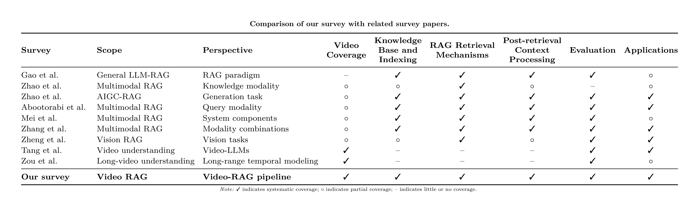</a>
</p>


</details>

---

## Taxonomy and Key Design Choices

Five interconnected design dimensions shape Video RAG systems: **evidence granularity, knowledge structure, retrieval strategy, modality alignment, and generator model**. They jointly determine evidence coverage, retrieval accuracy, computational cost, and answer quality.

<p align="center">
  <a href="imgC/videorag_design_framework.png">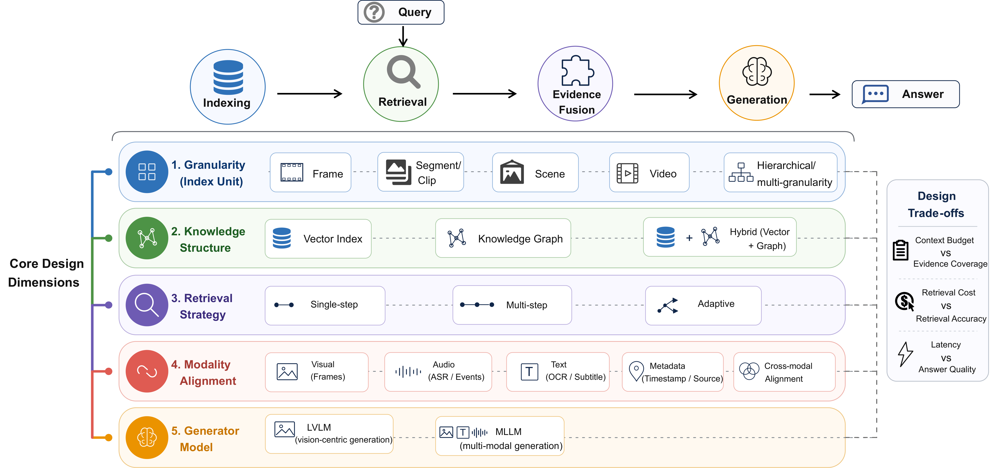</a>
</p>


<details>
<summary><strong>Design choices across the three workflow stages</strong></summary>


<p align="center">
  <a href="imgC/Table_Stage_Design_Mapping.png">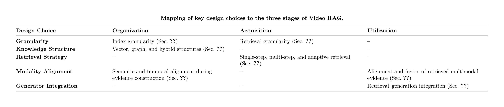</a>
</p>


</details>

---

## Video Knowledge Indexing and Representation

Video knowledge organization determines **what can be retrieved**. It includes corpus construction, multimodal content extraction, knowledge-base construction, and hybrid indexing.

### Multimodal Content Extraction

Visual frames and scene descriptions, **audio events and ASR**, **OCR and subtitles**, and temporal metadata are extracted and aligned into retrievable evidence units. Frame sampling may be uniform, keyframe-based, or adaptive.

<p align="center">
  <a href="imgC/multimodal-content-extraction-alignment.png"></a>
</p>


<details>
<summary><strong>Frame sampling strategies</strong></summary>


<p align="center">
  <a href="imgC/Table_Frame_Sampling.png">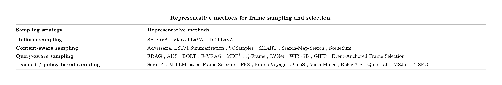</a>
</p>


</details>

<details>
<summary><strong>OCR for video evidence</strong></summary>


<p align="center">
  <a href="imgC/Table_OCR_Methods.png">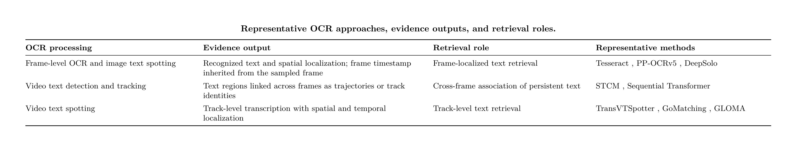</a>
</p>


</details>

### Knowledge-Base Construction and Hybrid Indexing

Video evidence can be indexed as **dense vectors**, **entities and relations in knowledge graphs**, or **hybrid and hierarchical memories**. These representations support different trade-offs between efficient semantic lookup, cross-event reasoning, and long-term context preservation.

<p align="center">
  <a href="imgC/Table_Knowledge_Structures.png">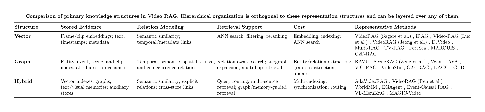</a>
</p>


<details>
<summary><strong>Persistent vector databases</strong></summary>


<p align="center">
  <a href="imgC/Table_Vector_Databases.png">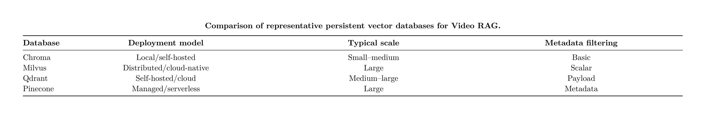</a>
</p>


</details>

---

## Retrieval Strategies and Mechanisms

Retrieval determines **which evidence is needed** for a query, **where to search**, and **how much evidence to return**. Typical operations include query rewriting, decomposition, modality-aware expansion, reranking, and temporal context expansion.

### Retrieval Granularity

The retrieval unit may be a **frame, clip, scene, video**, or an adaptive combination of levels. Finer units improve moment localization, while coarser units retain more contextual information.

<p align="center">
  <a href="imgC/multi_granular_retrieval.png"></a>
</p>


The following paper-derived table groups systems by their dominant retrieval granularity.

<p align="center">
  <a href="imgC/Table_Retrieval_Granularity.png">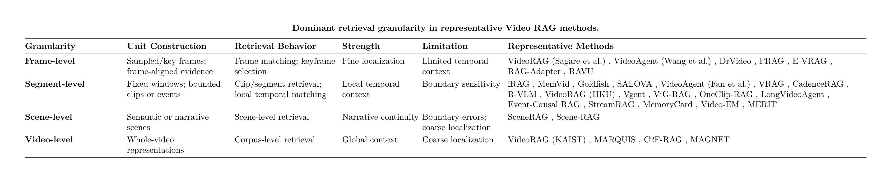</a>
</p>


### Retrieval Mechanism

- **Single-step retrieval:** selects relevant evidence in one retrieval pass.
- **Multi-step retrieval:** iteratively refines or expands evidence across retrieval steps.
- **Adaptive retrieval:** chooses the retrieval configuration, depth, modalities, or stopping conditions according to the query and evidence state.

<p align="center">
  <a href="imgC/retrieval_strategies.png"></a>
</p>


<p align="center">
  <a href="imgC/Table_Retrieval_Mechanisms.png">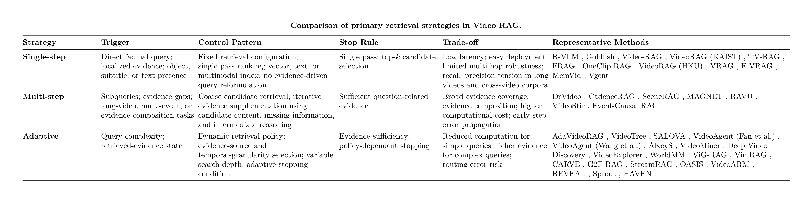</a>
</p>


**Post-retrieval processing** improves evidence usefulness through relevance filtering, reranking, deduplication, temporal expansion, and fusion of complementary retrieval channels.

---

## Retrieval Augmentation and Generation

After retrieval, evidence is aligned with the query, organized within the available context budget, and supplied to a generator to produce a **grounded response**.

### Multimodal Fusion

**Early fusion** combines evidence before the generator's main reasoning process; **mid fusion** integrates modalities through learned or intermediate representations; and **late fusion** consolidates outputs or evidence from multiple sources.

<p align="center">
  <a href="imgC/Table_Multimodal_Fusion.png"></a>
</p>


### Generator Models

Text-only LLMs can reason over textualized video records; LVLMs and MLLMs can incorporate retrieved visual evidence and additional modalities. Model selection affects context length, evidence format, computational cost, and grounding capabilities.

<p align="center">
  <a href="imgC/Table_Generator_Types_Systems.png"></a>
</p>


<details>
<summary><strong>Representative generative models</strong></summary>


<p align="center">
  <a href="imgC/Table_Generator_Models.png"></a>
</p>


</details>

### Integration Paradigms of Video RAG Systems

The survey distinguishes **training-enhanced integration** (including supervised and preference-based optimization) from **training-free integration**. Agentic workflows can orchestrate retrieval and generation within either setting.

<p align="center">
  <a href="imgC/Table_Integration_Paradigms.png"></a>
</p>


---

## Benchmarks and Datasets

Video RAG is evaluated on **video question answering, text–video retrieval, temporal grounding, long-video understanding, multi-hop reasoning, and streaming video analysis**. The resources below provide direct access to representative benchmarks, papers, and code.

| Benchmark          |                       Venue / year | Primary target                                               | Paper                                                        | Data / code                                                  |
| ------------------ | ---------------------------------: | ------------------------------------------------------------ | ------------------------------------------------------------ | ------------------------------------------------------------ |
| **NExT-QA**        |                          CVPR 2021 | Causal and temporal Video QA                                 | [Paper](https://openaccess.thecvf.com/content/CVPR2021/html/Xiao_NExT-QA_Next_Phase_of_Question-Answering_to_Explaining_Temporal_Actions_CVPR_2021_paper.html) | [Repository](https://github.com/doc-doc/NExT-QA)             |
| **QVHighlights**   | NeurIPS 2021 Datasets & Benchmarks | Query-based moment retrieval and highlight detection         | [Paper](https://proceedings.neurips.cc/paper_files/paper/2021/hash/62e0973455fd26eb03e91d5741a4a3bb-Abstract.html) | [Repository](https://github.com/jayleicn/moment_detr)        |
| **EgoSchema**      | NeurIPS 2023 Datasets & Benchmarks | Very long-form egocentric Video QA                           | [Paper](https://proceedings.neurips.cc/paper_files/paper/2023/hash/90ce332aff156b910b002ce4e6880dec-Abstract-Datasets_and_Benchmarks.html) | [Repository](https://github.com/egoschema/EgoSchema)         |
| **TVQA-Long**      |                          ECCV 2024 | Episode-length video understanding                           | [Goldfish paper](https://www.ecva.net/papers/eccv_2024/papers_ECCV/html/4213_ECCV_2024_paper.php) | [Repository](https://github.com/Vision-CAIR/MiniGPT4-video)  |
| **LongVideoBench** | NeurIPS 2024 Datasets & Benchmarks | Interleaved video-language understanding up to one hour      | [Paper](https://proceedings.neurips.cc/paper_files/paper/2024/hash/329ad516cf7a6ac306f29882e9c77558-Abstract-Datasets_and_Benchmarks_Track.html) | [Repository](https://github.com/longvideobench/LongVideoBench) |
| **Video-MME**      |                          CVPR 2025 | Multi-domain, multi-duration, multimodal video understanding | [Paper](https://openaccess.thecvf.com/content/CVPR2025/html/Fu_Video-MME_The_First-Ever_Comprehensive_Evaluation_Benchmark_of_Multi-modal_LLMs_in_CVPR_2025_paper.html) | [Repository](https://github.com/MME-Benchmarks/Video-MME)    |
| **MLVU**           |                          CVPR 2025 | Multi-task long-video understanding                          | [Paper](https://openaccess.thecvf.com/content/CVPR2025/html/Zhou_MLVU_Benchmarking_Multi-task_Long_Video_Understanding_CVPR_2025_paper.html) | [Repository](https://github.com/JUNJIE99/MLVU)               |
| **LVBench**        |                          ICCV 2025 | Extreme long-video comprehension and information extraction  | [Paper](https://openaccess.thecvf.com/content/ICCV2025/html/Wang_LVBench_An_Extreme_Long_Video_Understanding_Benchmark_ICCV_2025_paper.html) | [Repository](https://github.com/zai-org/LVBench)             |
| **HiVU**           |                       NeurIPS 2025 | Hierarchical and adaptive Video RAG                          | [AdaVideoRAG paper](https://proceedings.neurips.cc/paper_files/paper/2025/hash/092359ce5cf60a80e882378944bf1be4-Abstract-Conference.html) | [Repository](https://github.com/xzc-zju/AdaVideoRAG)         |
| **LongerVideos**   |                           KDD 2026 | Extreme long-context and cross-video reasoning               | [VideoRAG paper](https://doi.org/10.1145/3770854.3783944)    | [Repository](https://github.com/HKUDS/VideoRAG)              |
| **V-RAGBench**     |                               2026 | Decoupled retrieval and generation with uniquely sufficient evidence chunks | [CARVE paper](https://arxiv.org/abs/2606.13141)              | —                                                            |
| **LongVidSearch**  |                               2026 | Agentic 2–4 hop evidence retrieval planning under a standardized interface | [Paper](https://arxiv.org/abs/2603.14468)                    | [Dataset](https://huggingface.co/datasets/Fishiing/LongVidSearch) |

<details>
<summary><strong>Complete benchmark taxonomy from the survey</strong></summary>


<p align="center">
  <a href="imgC/Table_Video_Benchmarks.png">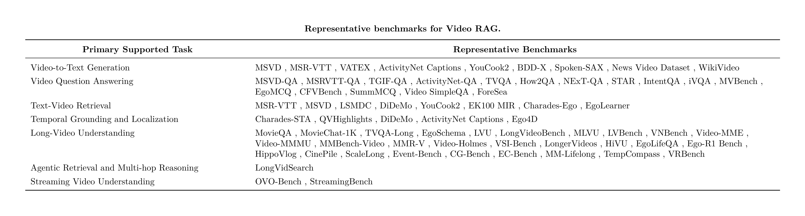</a>
</p>


</details>

---

## Evaluation

Answer accuracy alone does not identify whether a Video RAG system has retrieved the right evidence, localized the correct moment, or generated a well-supported answer. Evaluation should jointly assess **retrieval, grounding, generation, robustness, and efficiency**.

<p align="center">
  <a href="imgC/Fig9_Evaluation.png"></a>
</p>


| Dimension                 | Representative metrics / protocols                           |
| ------------------------- | ------------------------------------------------------------ |
| **Evidence retrieval**    | Recall@K, Precision@K, F1@K, Hit Rate, mAP, nDCG, MRR, MedR, MnR |
| **Temporal grounding**    | tIoU, mIoU, IoU-thresholded Recall@K, MTGS                   |
| **Citation attribution**  | CiteP, CiteR, CiteF1; support of generated claims by cited video evidence |
| **Answer generation**     | Accuracy, Exact Match, F1, ANLS, BLEU, METEOR, ROUGE, CIDEr, BERTScore, STEM, InfoP, InfoR, InfoF1, LLM-as-a-judge |
| **Long-video robustness** | Length-stratified accuracy, performance over increasing video duration |
| **Cross-video reasoning** | Long-range and multi-video reasoning scores; evidence coverage across events and sources |
| **System efficiency**     | Retrieval and end-to-end latency, wall-clock time, memory, TFLOPs, processed frames and tokens |

For reproducibility, report the **video duration**, **frame-sampling budget**, **retrieved evidence count and granularity**, **used modalities**, **indexing cost**, **generator**, and **inference settings** alongside answer metrics.

<details>
<summary><strong>Additional system-level evaluation dimensions</strong></summary>


<p align="center">
  <a href="imgC/Table_Evaluation_Mapping.png">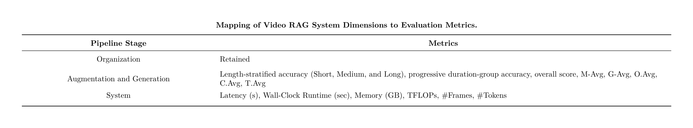</a>
</p>


</details>

---

## Paper Collection

Research papers are listed chronologically. **†** denotes RAG-adjacent methods, which contribute reusable retrieval, memory, or reasoning components but do not necessarily instantiate the complete Video RAG pipeline.

| Year | Paper                                                        | Venue / Source                                               |                         Code                          |
| :--: | ------------------------------------------------------------ | ------------------------------------------------------------ | :---------------------------------------------------: |
| 2018 | [**Know-Aware VD** — Incorporating background knowledge into video description generation](https://aclanthology.org/D18-1433/) | EMNLP 2018                                                   |                           —                           |
| 2023 | [Chatvideo: A tracklet-centric multimodal and versatile video understanding system](https://arxiv.org/abs/2304.14407) | arXiv 2023                                                   |    [Code](https://github.com/yiwengxie/Chat-Video)    |
| 2023 | [**R-ConvED** — Retrieval augmented convolutional encoder-decoder networks for video captioning](https://doi.org/10.1145/3539225) | ACM TOMM 2023                                                |                           —                           |
| 2023 | [**R2A** — Retrieving-to-answer: Zero-shot video question answering with frozen large language models](https://openaccess.thecvf.com/content/ICCV2023W/MMFM/html/Pan_Retrieving-to-Answer_Zero-Shot_Video_Question_Answering_with_Frozen_Large_Language_Models_ICCVW_2023_paper.html) | ICCVW 2023                                                   |                           —                           |
| 2023 | [**SeViLA** — Self-chained image-language model for video localization and question answering](https://proceedings.neurips.cc/paper_files/paper/2023/hash/f22a9af8dbb348952b08bd58d4734b50-Abstract-Conference.html) | NeurIPS 2023                                                 |      [Code](https://github.com/Yui010206/SeViLA)      |
| 2024 | [**Enhance-RAG** — Enhancing Video Retrieval via Synergized Image Embeddings and RAG †](https://scholar.google.com/scholar?q=Enhancing%20Video%20Retrieval%20via%20Synergized%20Image%20Embeddings%20and%20RAG) | SoICT 2024                                                   |                           —                           |
| 2024 | [Goldfish: Vision-language understanding of arbitrarily long videos](https://www.ecva.net/papers/eccv_2024/papers_ECCV/html/4213_ECCV_2024_paper.php) | ECCV 2024                                                    | [Code](https://github.com/Vision-CAIR/MiniGPT4-video) |
| 2024 | [irag: Advancing rag for videos with an incremental approach](https://doi.org/10.1145/3627673.3680088) | CIKM 2024                                                    |                           —                           |
| 2024 | [Ma-lmm: Memory-augmented large multimodal model for long-term video understanding †](https://openaccess.thecvf.com/content/CVPR2024/html/He_MA-LMM_Memory-Augmented_Large_Multimodal_Model_for_Long-Term_Video_Understanding_CVPR_2024_paper.html) | CVPR 2024                                                    |       [Code](https://github.com/boheumd/MA-LMM)       |
| 2024 | [Rag-driver: Generalisable driving explanations with retrieval-augmented in-context learning in multi-modal large language model](https://arxiv.org/abs/2402.10828) | arXiv 2024                                                   |                           —                           |
| 2024 | [**EgoInstructor** — Retrieval-augmented egocentric video captioning](https://openaccess.thecvf.com/content/CVPR2024/html/Xu_Retrieval-Augmented_Egocentric_Video_Captioning_CVPR_2024_paper.html) | CVPR 2024                                                    | [Code](https://github.com/Jazzcharles/Egoinstructor)  |
| 2024 | [**RAG-Indoor** — Retrieval-augmented-generation-enhanced Dense Video Caption for Human Indoor Activities: Disambiguating Caption Using Spatial Information Beyond Field of View Constraints](https://scholar.google.com/scholar?q=Retrieval-augmented-generation-enhanced%20Dense%20Video%20Caption%20for%20Human%20Indoor%20Activities%3A%20Disambiguating%20Caption%20Using%20Spatial%20Information%20Beyond%20Field%20of%20View%20Constraints) | Sensors & Materials 2024                                     |                           —                           |
| 2024 | [Videoagent: A memory-augmented multimodal agent for video understanding](https://www.ecva.net/papers/eccv_2024/papers_ECCV/html/3241_ECCV_2024_paper.php) | ECCV 2024                                                    |   [Code](https://github.com/YueFan1014/VideoAgent)    |
| 2024 | [Vita: An efficient video-to-text algorithm using vlm for rag-based video analysis system](https://openaccess.thecvf.com/content/CVPR2024W/MAR/html/Arefeen_ViTA_An_Efficient_Video-to-Text_Algorithm__using_VLM_for_RAG-based_CVPRW_2024_paper.html) | CVPRW 2024                                                   |                           —                           |
| 2025 | [AdaVideoRAG: Omni-Contextual Adaptive Retrieval-Augmented Efficient Long Video Understanding](https://proceedings.neurips.cc/paper_files/paper/2025/hash/092359ce5cf60a80e882378944bf1be4-Abstract-Conference.html) | NeurIPS 2025                                                 |    [Code](https://github.com/xzc-zju/AdaVideoRAG)     |
| 2025 | [Cadencerag: Context-aware and dependency-enhanced retrieval augmented generation for holistic video understanding](https://scholar.google.com/scholar?q=Cadencerag%3A%20Context-aware%20and%20dependency-enhanced%20retrieval%20augmented%20generation%20for%20holistic%20video%20understanding) | CVPR 2025                                                    |                           —                           |
| 2025 | [Drvideo: Document retrieval based long video understanding](https://openaccess.thecvf.com/content/CVPR2025/html/Ma_DrVideo_Document_Retrieval_Based_Long_Video_Understanding_CVPR_2025_paper.html) | CVPR 2025                                                    |     [Code](https://github.com/Upper9527/DrVideo)      |
| 2025 | [E-vrag: Enhancing long video understanding with resource-efficient retrieval augmented generation](https://arxiv.org/abs/2508.01546) | arXiv 2025                                                   |                           —                           |
| 2025 | [FilterRAG: zero-shot informed retrieval-augmented generation to mitigate hallucinations in VQA](https://arxiv.org/abs/2502.18536) | arXiv 2025                                                   |                           —                           |
| 2025 | [Frag: Frame selection augmented generation for long video and long document understanding](https://arxiv.org/abs/2504.17447) | arXiv 2025                                                   |        [Code](https://github.com/NVlabs/FRAG)         |
| 2025 | [LightVideoRAG: Low-Resource Long Video Question-Answering via Adaptive Sampling and Context-Aware Retrieval](https://scholar.google.com/scholar?q=LightVideoRAG%3A%20Low-Resource%20Long%20Video%20Question-Answering%20via%20Adaptive%20Sampling%20and%20Context-Aware%20Retrieval) | Advances in Mobile Computing & Multimedia Intelligence (2025) |                           —                           |
| 2025 | [**MemVid** — Memory-enhanced retrieval augmentation for long video understanding](https://arxiv.org/abs/2503.09149) | arXiv 2025                                                   |                           —                           |
| 2025 | [Salova: Segment-augmented long video assistant for targeted retrieval and routing in long-form video analysis](https://openaccess.thecvf.com/content/CVPR2025/html/Kim_SALOVA_Segment-Augmented_Long_Video_Assistant_for_Targeted_Retrieval_and_Routing_CVPR_2025_paper.html) | CVPR 2025                                                    |      [Code](https://github.com/IVY-LVLM/SALOVA)       |
| 2025 | [**Video Swagger** — Social Media Video Creation: Harnessing the Power of Large Language Models for Non-Linear Editing and RAG-Based Question-Answering](https://scholar.google.com/scholar?q=Social%20Media%20Video%20Creation%3A%20Harnessing%20the%20Power%20of%20Large%20Language%20Models%20for%20Non-Linear%20Editing%20and%20RAG-Based%20Question-Answering) | ICCTDC 2025                                                  |                           —                           |
| 2025 | [**RAPO** — The devil is in the prompts: Retrieval-augmented prompt optimization for text-to-video generation](https://scholar.google.com/scholar?q=The%20devil%20is%20in%20the%20prompts%3A%20Retrieval-augmented%20prompt%20optimization%20for%20text-to-video%20generation) | CVPR 2025                                                    |                           —                           |
| 2025 | [**OneClip-RAG** — Towards Effective Long Video Understanding of Multimodal Large Language Models via One-shot Clip Retrieval](https://arxiv.org/abs/2512.08410) | arXiv 2025                                                   |                           —                           |
| 2025 | [Tv-rag: A temporal-aware and semantic entropy-weighted framework for long video retrieval and understanding](https://doi.org/10.1145/3746027.3755873) | ACM MM 2025                                                  | [Code](https://github.com/AI-Researcher-Team/TV-RAG)  |
| 2025 | [Vgent: Graph-based retrieval-reasoning-augmented generation for long video understanding](https://proceedings.neurips.cc/paper_files/paper/2025/hash/91b75715a2ae8f2542b78be31941eac3-Abstract-Conference.html) | NeurIPS 2025                                                 |    [Code](https://github.com/xiaoqian-shen/Vgent)     |
| 2025 | [Video-rag: Visually-aligned retrieval-augmented long video comprehension](https://papers.nips.cc/paper_files/paper/2025/hash/f593c9c251d4d7cf14d4ab9861dfb7eb-Abstract-Conference.html) | NeurIPS 2025                                                 | [Code](https://github.com/Leon1207/Video-RAG-master)  |
| 2025 | [Videoexplorer: Think with videos for agentic long-video understanding](https://arxiv.org/abs/2506.10821) | arXiv 2025                                                   |                           —                           |
| 2025 | [**VideoRAG (KAIST)** — Videorag: Retrieval-augmented generation over video corpus](https://aclanthology.org/2025.findings-acl.1096/) | Findings ACL 2025                                            |     [Code](https://github.com/starsuzi/VideoRAG)      |
| 2025 | [Videotree: Adaptive tree-based video representation for llm reasoning on long videos](https://openaccess.thecvf.com/content/CVPR2025/html/Wang_VideoTree_Adaptive_Tree-based_Video_Representation_for_LLM_Reasoning_on_Long_CVPR_2025_paper.html) | CVPR 2025                                                    |    [Code](https://github.com/Ziyang412/VideoTree)     |
| 2025 | [Vrag: Retrieval-augmented video question answering for long-form videos](https://scholar.google.com/scholar?q=Vrag%3A%20Retrieval-augmented%20video%20question%20answering%20for%20long-form%20videos) | CVPR 2025                                                    |                           —                           |
| 2025 | [X-cot: Explainable text-to-video retrieval via llm-based chain-of-thought reasoning †](https://scholar.google.com/scholar?q=X-cot%3A%20Explainable%20text-to-video%20retrieval%20via%20llm-based%20chain-of-thought%20reasoning) | EMNLP 2025                                                   |                           —                           |
| 2026 | [**EGAgent** — Agentic very long video understanding](https://scholar.google.com/scholar?q=Agentic%20very%20long%20video%20understanding) | ACL 2026                                                     |                           —                           |
| 2026 | [AVA: Towards Agentic Video Analytics with Vision Language Models](https://scholar.google.com/scholar?q=AVA%3A%20Towards%20Agentic%20Video%20Analytics%20with%20Vision%20Language%20Models) | USENIX NSDI 2026                                             |                           —                           |
| 2026 | [**GEB** — Beyond the Timeline: Augmenting Long-Video Memory with Grounded Entity Biographies](https://arxiv.org/abs/2609.38155) | arXiv 2026                                                   |                           —                           |
| 2026 | [**DAGC** — Coarse Indexing, Fine Evidence: Decoupling Temporal Granularity in Long-Video RAG](https://arxiv.org/abs/2608.23011) | arXiv 2026                                                   |                           —                           |
| 2026 | [**C2F-RAG** — Decoupling semantics and logic: A training-free coarse-to-fine pipeline for video retrieval-augmented generation](https://scholar.google.com/scholar?q=Decoupling%20semantics%20and%20logic%3A%20A%20training-free%20coarse-to-fine%20pipeline%20for%20video%20retrieval-augmented%20generation) | MAGMaR 2026                                                  |                           —                           |
| 2026 | [Event-anchored frame selection for effective long-video understanding](https://arxiv.org/abs/2603.00983) | arXiv 2026                                                   |                           —                           |
| 2026 | [Event-Causal RAG: A Retrieval-Augmented Generation Framework for Long Video Reasoning in Complex Scenarios](https://arxiv.org/abs/2605.06185) | arXiv 2026                                                   |                           —                           |
| 2026 | [FastV-RAG: Towards Fast and Fine-Grained Video QA with Retrieval-Augmented Generation](https://scholar.google.com/scholar?q=FastV-RAG%3A%20Towards%20Fast%20and%20Fine-Grained%20Video%20QA%20with%20Retrieval-Augmented%20Generation) | ACL 2026                                                     |                           —                           |
| 2026 | [ForeSea: AI forensic search with multi-modal queries for video surveillance](https://scholar.google.com/scholar?q=ForeSea%3A%20AI%20forensic%20search%20with%20multi-modal%20queries%20for%20video%20surveillance) | ECCV 2026                                                    |                           —                           |
| 2026 | [Graph-to-Frame RAG: Visual-Space Knowledge Fusion for Training-Free and Auditable Video Reasoning](https://arxiv.org/abs/2604.04372) | arXiv 2026                                                   |                           —                           |
| 2026 | [**HAVEN** — Hierarchical Long Video Understanding with Audiovisual Entity Cohesion and Agentic Search](https://arxiv.org/abs/2601.13719) | arXiv 2026                                                   |                           —                           |
| 2026 | [**MERIT** — Keep it simple: Multi-key episodic memory retrieval for ultra-long video understanding](https://scholar.google.com/scholar?q=Keep%20it%20simple%3A%20Multi-key%20episodic%20memory%20retrieval%20for%20ultra-long%20video%20understanding) | ECCV 2026                                                    |                           —                           |
| 2026 | [**R-VLM** — Long video understanding with learnable retrieval in video-language models](https://scholar.google.com/scholar?q=Long%20video%20understanding%20with%20learnable%20retrieval%20in%20video-language%20models) | IEEE Transactions on Multimedia 2026                         |                           —                           |
| 2026 | [Magnet: A multi-agent framework for finding audio-visual needles by reasoning over multi-video haystacks](https://scholar.google.com/scholar?q=Magnet%3A%20A%20multi-agent%20framework%20for%20finding%20audio-visual%20needles%20by%20reasoning%20over%20multi-video%20haystacks) | NeurIPS 2026                                                 |                           —                           |
| 2026 | [Marquis: A three-stage pipeline for video retrieval-augmented generation](https://scholar.google.com/scholar?q=Marquis%3A%20A%20three-stage%20pipeline%20for%20video%20retrieval-augmented%20generation) | MAGMaR 2026                                                  |                           —                           |
| 2026 | [**MAVIS** — Multi-Agent Video Intelligent System for Educational and Archival Video Analysis](https://scholar.google.com/scholar?q=Multi-Agent%20Video%20Intelligent%20System%20for%20Educational%20and%20Archival%20Video%20Analysis) | ICIPCN 2026                                                  |                           —                           |
| 2026 | [Multi-rag: A multimodal retrieval-augmented generation system for adaptive video understanding](https://scholar.google.com/scholar?q=Multi-rag%3A%20A%20multimodal%20retrieval-augmented%20generation%20system%20for%20adaptive%20video%20understanding) | PAKDD 2025                                                   |                           —                           |
| 2026 | [**NR-MV-RAG** — Noise-Resilient Multimodal Video RAG Enhancing Urdu Retrieval](https://scholar.google.com/scholar?q=Noise-Resilient%20Multimodal%20Video%20RAG%20Enhancing%20Urdu%20Retrieval) | iCoMET 2026                                                  |                           —                           |
| 2026 | [OASIS: On-Demand Hierarchical Event Memory for Streaming Video Reasoning](https://arxiv.org/abs/2604.17052) | arXiv 2026                                                   |                           —                           |
| 2026 | [Qualirag: Retrieval-augmented generation for visual quality understanding](https://arxiv.org/abs/2601.18195) | arXiv 2026                                                   |                           —                           |
| 2026 | [Ravu: Retrieval augmented video understanding with compositional reasoning over graph](https://openaccess.thecvf.com/content/WACV2026/html/Malik_RAVU_Retrieval_Augmented_Video_Understanding_with_Compositional_Reasoning_over_Graph_WACV_2026_paper.html) | WACV 2026                                                    |                           —                           |
| 2026 | [Refocus: Reinforcement-guided frame optimization for contextual understanding](https://scholar.google.com/scholar?q=Refocus%3A%20Reinforcement-guided%20frame%20optimization%20for%20contextual%20understanding) | CVPR 2026                                                    |                           —                           |
| 2026 | [**CARVE / V-RAGBench** — Rethinking RAG in Long Videos: What to Retrieve and How to Use It?](https://arxiv.org/abs/2606.13141) | arXiv 2026                                                   |                           —                           |
| 2026 | [REVEAL: A Rubric-Guided Agent for Explicit Evidence Sufficiency Verificationin Long-Video Question Answering](https://arxiv.org/abs/2608.08612) | arXiv 2026                                                   |                           —                           |
| 2026 | [**VideoRAG (ZJU)** — Rewind-Augmented Generation for Long Video Understanding](https://scholar.google.com/scholar?q=Rewind-Augmented%20Generation%20for%20Long%20Video%20Understanding) | IEEE Transactions on Multimedia 2026                         |                           —                           |
| 2026 | [SafeScreen: A Safety-First Screening Framework for Personalized Video Retrieval for Vulnerable Users](https://arxiv.org/abs/2604.03264) | arXiv 2026                                                   |                           —                           |
| 2026 | [**VideoRAG (VIT)** — Scalable Multilingual Retrieval of Lecture Moments Through Whisper-Based Transcripts and Vector Search †](https://scholar.google.com/scholar?q=Scalable%20Multilingual%20Retrieval%20of%20Lecture%20Moments%20Through%20Whisper-Based%20Transcripts%20and%20Vector%20Search) | IEEE Access 2026                                             |                           —                           |
| 2026 | [Scenerag: Scene-level retrieval-augmented generation for video understanding](https://arxiv.org/abs/2506.07600) | ICASSP 2026                                                  |                           —                           |
| 2026 | [Sprout: Building Dynamic Memory While Reasoning for Agentic Video Understanding](https://arxiv.org/abs/2609.35497) | arXiv 2026                                                   |                           —                           |
| 2026 | [StreamRAG: Enhancing Real-Time Video Understanding with Retrieval Augmentation](https://openaccess.thecvf.com/content/CVPR2026/html/Xie_StreamRAG_Enhancing_Real-Time_Video_Understanding_with_Retrieval_Augmentation_CVPR_2026_paper.html) | CVPR 2026                                                    |                           —                           |
| 2026 | [TRACE: Evidence Grounding-Guided Multi-Video Event Understanding and Claim Generation](https://scholar.google.com/scholar?q=TRACE%3A%20Evidence%20Grounding-Guided%20Multi-Video%20Event%20Understanding%20and%20Claim%20Generation) | MAGMaR 2026                                                  |                           —                           |
| 2026 | [TrafficRAG: Temporal Grounding for Traffic Violations via Retrieval-Augmented Generation](https://scholar.google.com/scholar?q=TrafficRAG%3A%20Temporal%20Grounding%20for%20Traffic%20Violations%20via%20Retrieval-Augmented%20Generation) | WACV 2026                                                    |                           —                           |
| 2026 | [UrbanClipAtlas: A Visual Analytics Framework for Event and Scene Retrieval in Urban Videos](https://scholar.google.com/scholar?q=UrbanClipAtlas%3A%20A%20Visual%20Analytics%20Framework%20for%20Event%20and%20Scene%20Retrieval%20in%20Urban%20Videos) | Computer Graphics Forum                                      |                           —                           |
| 2026 | [Videoarm: Agentic reasoning over hierarchical memory for long-form video understanding](https://scholar.google.com/scholar?q=Videoarm%3A%20Agentic%20reasoning%20over%20hierarchical%20memory%20for%20long-form%20video%20understanding) | CVPR 2026                                                    |                           —                           |
| 2026 | [Videochat-m1: Collaborative policy planning for video understanding via multi-agent reinforcement learning](https://scholar.google.com/scholar?q=Videochat-m1%3A%20Collaborative%20policy%20planning%20for%20video%20understanding%20via%20multi-agent%20reinforcement%20learning) | CVPR 2026                                                    |                           —                           |
| 2026 | [**VideoRAG (HKU)** — Videorag: Retrieval-augmented generation with extreme long-context videos](https://doi.org/10.1145/3770854.3783944) | KDD 2026                                                     |       [Code](https://github.com/HKUDS/VideoRAG)       |
| 2026 | [Videostir: Understanding long videos via spatio-temporally structured and intent-aware rag](https://aclanthology.org/2026.acl-long.1656/) | ACL 2026                                                     |      [Code](https://github.com/RomGai/VideoStir)      |
| 2026 | [ViG-RAG: Video-aware Graph Retrieval-Augmented Generation via Temporal and Semantic Hybrid Reasoning](https://doi.org/10.1609/aaai.v40i1.36963) | AAAI 2026                                                    | [Code](https://github.com/AI-Researcher-Team/ViG-RAG) |
| 2026 | [Vimorag: Video-based retrieval-augmented 3d motion generation for motion language models](https://scholar.google.com/scholar?q=Vimorag%3A%20Video-based%20retrieval-augmented%203d%20motion%20generation%20for%20motion%20language%20models) | NeurIPS 2026                                                 |                           —                           |
| 2026 | [Wikivideo: Article generation from multiple videos](https://scholar.google.com/scholar?q=Wikivideo%3A%20Article%20generation%20from%20multiple%20videos) | Findings ACL 2026                                            |                           —                           |
| 2026 | [Worldmm: Dynamic multimodal memory agent for long video reasoning](https://openaccess.thecvf.com/content/CVPR2026/html/Yeo_WorldMM_Dynamic_Multimodal_Memory_Agent_for_Long_Video_Reasoning_CVPR_2026_paper.html) | CVPR 2026                                                    |       [Code](https://github.com/wgcyeo/WorldMM)       |
|  —   | [VideoTrace-R1: Long Video-based Retrieval-Augmented Generation via Reinforcement Learning](https://scholar.google.com/scholar?q=VideoTrace-R1%3A%20Long%20Video-based%20Retrieval-Augmented%20Generation%20via%20Reinforcement%20Learning) | ICML (year absent in BibTeX)                                 |                           —                           |

<details>
<summary><strong>Additional cited literature: surveys, enabling methods, datasets and evaluation</strong></summary>


| Year | Paper                                                        | Venue / Source                                             |
| :--: | ------------------------------------------------------------ | ---------------------------------------------------------- |
| 2006 | [Spoken document retrieval from call-center conversations](https://scholar.google.com/scholar?q=Spoken%20document%20retrieval%20from%20call-center%20conversations) | SIGIR 2006                                                 |
| 2007 | [An overview of the Tesseract OCR engine](https://scholar.google.com/scholar?q=An%20overview%20of%20the%20Tesseract%20OCR%20engine) | ICDAR 2007                                                 |
| 2009 | [Reciprocal rank fusion outperforms condorcet and individual rank learning methods](https://scholar.google.com/scholar?q=Reciprocal%20rank%20fusion%20outperforms%20condorcet%20and%20individual%20rank%20learning%20methods) | SIGIR 2009                                                 |
| 2011 | [Collecting highly parallel data for paraphrase evaluation](https://scholar.google.com/scholar?q=Collecting%20highly%20parallel%20data%20for%20paraphrase%20evaluation) | ACL 2011                                                   |
| 2015 | [Sequence to sequence-video to text](https://scholar.google.com/scholar?q=Sequence%20to%20sequence-video%20to%20text) | ICCV 2015                                                  |
| 2016 | [Movieqa: Understanding stories in movies through question-answering](https://scholar.google.com/scholar?q=Movieqa%3A%20Understanding%20stories%20in%20movies%20through%20question-answering) | CVPR 2016                                                  |
| 2016 | [Msr-vtt: A large video description dataset for bridging video and language](https://scholar.google.com/scholar?q=Msr-vtt%3A%20A%20large%20video%20description%20dataset%20for%20bridging%20video%20and%20language) | CVPR 2016                                                  |
| 2017 | [Dense-captioning events in videos](https://scholar.google.com/scholar?q=Dense-captioning%20events%20in%20videos) | ICCV 2017                                                  |
| 2017 | [Localizing moments in video with natural language](https://scholar.google.com/scholar?q=Localizing%20moments%20in%20video%20with%20natural%20language) | ICCV 2017                                                  |
| 2017 | [Movie description](https://scholar.google.com/scholar?q=Movie%20description) | International Journal of Computer Vision 2017              |
| 2017 | [Tall: Temporal activity localization via language query](https://scholar.google.com/scholar?q=Tall%3A%20Temporal%20activity%20localization%20via%20language%20query) | ICCV 2017                                                  |
| 2017 | [Tgif-qa: Toward spatio-temporal reasoning in visual question answering](https://scholar.google.com/scholar?q=Tgif-qa%3A%20Toward%20spatio-temporal%20reasoning%20in%20visual%20question%20answering) | CVPR 2017                                                  |
| 2017 | [Unsupervised video summarization with adversarial lstm networks](https://scholar.google.com/scholar?q=Unsupervised%20video%20summarization%20with%20adversarial%20lstm%20networks) | CVPR 2017                                                  |
| 2017 | [Video question answering via gradually refined attention over appearance and motion](https://scholar.google.com/scholar?q=Video%20question%20answering%20via%20gradually%20refined%20attention%20over%20appearance%20and%20motion) | ACM MM 2017                                                |
| 2018 | [Charades-ego: A large-scale dataset of paired third and first person videos](https://arxiv.org/abs/1804.09626) | arXiv 2018                                                 |
| 2018 | [Textual explanations for self-driving vehicles](https://scholar.google.com/scholar?q=Textual%20explanations%20for%20self-driving%20vehicles) | ECCV 2018                                                  |
| 2018 | [Towards automatic learning of procedures from web instructional videos](https://scholar.google.com/scholar?q=Towards%20automatic%20learning%20of%20procedures%20from%20web%20instructional%20videos) | AAAI 2018                                                  |
| 2018 | [Tvqa: Localized, compositional video question answering](https://scholar.google.com/scholar?q=Tvqa%3A%20Localized%2C%20compositional%20video%20question%20answering) | EMNLP 2018                                                 |
| 2019 | [Activitynet-qa: A dataset for understanding complex web videos via question answering](https://scholar.google.com/scholar?q=Activitynet-qa%3A%20A%20dataset%20for%20understanding%20complex%20web%20videos%20via%20question%20answering) | AAAI 2019                                                  |
| 2019 | [Audiocaps: Generating captions for audios in the wild](https://scholar.google.com/scholar?q=Audiocaps%3A%20Generating%20captions%20for%20audios%20in%20the%20wild) | ACL 2019                                                   |
| 2019 | [Howto100m: Learning a text-video embedding by watching hundred million narrated video clips](https://scholar.google.com/scholar?q=Howto100m%3A%20Learning%20a%20text-video%20embedding%20by%20watching%20hundred%20million%20narrated%20video%20clips) | ICCV 2019                                                  |
| 2019 | [Scsampler: Sampling salient clips from video for efficient action recognition](https://scholar.google.com/scholar?q=Scsampler%3A%20Sampling%20salient%20clips%20from%20video%20for%20efficient%20action%20recognition) | ICCV 2019                                                  |
| 2019 | [Vatex: A large-scale, high-quality multilingual dataset for video-and-language research](https://scholar.google.com/scholar?q=Vatex%3A%20A%20large-scale%2C%20high-quality%20multilingual%20dataset%20for%20video-and-language%20research) | ICCV 2019                                                  |
| 2020 | [End-to-end learning of visual representations from uncurated instructional videos](https://scholar.google.com/scholar?q=End-to-end%20learning%20of%20visual%20representations%20from%20uncurated%20instructional%20videos) | CVPR 2020                                                  |
| 2020 | [Hero: Hierarchical encoder for video+ language omni-representation pre-training](https://scholar.google.com/scholar?q=Hero%3A%20Hierarchical%20encoder%20for%20video%2B%20language%20omni-representation%20pre-training) | EMNLP 2020                                                 |
| 2020 | [Panns: Large-scale pretrained audio neural networks for audio pattern recognition](https://scholar.google.com/scholar?q=Panns%3A%20Large-scale%20pretrained%20audio%20neural%20networks%20for%20audio%20pattern%20recognition) | IEEE/ACM Transactions on Audio, Speech, and Language… 2020 |
| 2020 | [Retrieval-augmented generation for knowledge-intensive nlp tasks](https://scholar.google.com/scholar?q=Retrieval-augmented%20generation%20for%20knowledge-intensive%20nlp%20tasks) | NeurIPS 2020                                               |
| 2021 | [A bilingual, openworld video text dataset and end-to-end video text spotter with transformer](https://arxiv.org/abs/2112.04888) | arXiv 2021                                                 |
| 2021 | [Detecting moments and highlights in videos via natural language queries](https://proceedings.neurips.cc/paper_files/paper/2021/hash/62e0973455fd26eb03e91d5741a4a3bb-Abstract.html) | NeurIPS 2021                                               |
| 2021 | [Frozen in time: A joint video and image encoder for end-to-end retrieval](https://scholar.google.com/scholar?q=Frozen%20in%20time%3A%20A%20joint%20video%20and%20image%20encoder%20for%20end-to-end%20retrieval) | ICCV 2021                                                  |
| 2021 | [Gpt-neo: Large scale autoregressive language modeling with mesh-tensorflow](https://scholar.google.com/scholar?q=Gpt-neo%3A%20Large%20scale%20autoregressive%20language%20modeling%20with%20mesh-tensorflow) | Zenodo 2021                                                |
| 2021 | [Just ask: Learning to answer questions from millions of narrated videos](https://scholar.google.com/scholar?q=Just%20ask%3A%20Learning%20to%20answer%20questions%20from%20millions%20of%20narrated%20videos) | ICCV 2021                                                  |
| 2021 | [Learning transferable visual models from natural language supervision](https://scholar.google.com/scholar?q=Learning%20transferable%20visual%20models%20from%20natural%20language%20supervision) | ICML 2021                                                  |
| 2021 | [Next-qa: Next phase of question-answering to explaining temporal actions](https://openaccess.thecvf.com/content/CVPR2021/html/Xiao_NExT-QA_Next_Phase_of_Question-Answering_to_Explaining_Temporal_Actions_CVPR_2021_paper.html) | CVPR 2021                                                  |
| 2021 | [Smart frame selection for action recognition](https://scholar.google.com/scholar?q=Smart%20frame%20selection%20for%20action%20recognition) | AAAI 2021                                                  |
| 2021 | [Towards long-form video understanding](https://scholar.google.com/scholar?q=Towards%20long-form%20video%20understanding) | CVPR 2021                                                  |
| 2021 | [Video text tracking with a spatio-temporal complementary model](https://scholar.google.com/scholar?q=Video%20text%20tracking%20with%20a%20spatio-temporal%20complementary%20model) | IEEE transactions on image processing 2021                 |
| 2021 | [Videoclip: Contrastive pre-training for zero-shot video-text understanding](https://scholar.google.com/scholar?q=Videoclip%3A%20Contrastive%20pre-training%20for%20zero-shot%20video-text%20understanding) | EMNLP 2021                                                 |
| 2022 | [Audioclip: Extending clip to image, text and audio](https://scholar.google.com/scholar?q=Audioclip%3A%20Extending%20clip%20to%20image%2C%20text%20and%20audio) | ICASSP 2022                                                |
| 2022 | [Clip4clip: An empirical study of clip for end to end video clip retrieval and captioning](https://scholar.google.com/scholar?q=Clip4clip%3A%20An%20empirical%20study%20of%20clip%20for%20end%20to%20end%20video%20clip%20retrieval%20and%20captioning) | Neurocomputing 2022                                        |
| 2022 | [Ego4d: Around the world in 3,000 hours of egocentric video](https://scholar.google.com/scholar?q=Ego4d%3A%20Around%20the%20world%20in%203%2C000%20hours%20of%20egocentric%20video) | CVPR 2022                                                  |
| 2022 | [Egocentric video-language pretraining](https://scholar.google.com/scholar?q=Egocentric%20video-language%20pretraining) | NeurIPS 2022                                               |
| 2022 | [Internvideo: General video foundation models via generative and discriminative learning](https://arxiv.org/abs/2212.03191) | arXiv 2022                                                 |
| 2022 | [Murag: Multimodal retrieval-augmented generator for open question answering over images and text](https://scholar.google.com/scholar?q=Murag%3A%20Multimodal%20retrieval-augmented%20generator%20for%20open%20question%20answering%20over%20images%20and%20text) | EMNLP 2022                                                 |
| 2022 | [Object-aware video-language pre-training for retrieval](https://scholar.google.com/scholar?q=Object-aware%20video-language%20pre-training%20for%20retrieval) | CVPR 2022                                                  |
| 2022 | [On the impact of speech recognition errors in passage retrieval for spoken question answering](https://scholar.google.com/scholar?q=On%20the%20impact%20of%20speech%20recognition%20errors%20in%20passage%20retrieval%20for%20spoken%20question%20answering) | CIKM 2022                                                  |
| 2022 | [Rescaling egocentric vision: Collection, pipeline and challenges for epic-kitchens-100](https://scholar.google.com/scholar?q=Rescaling%20egocentric%20vision%3A%20Collection%2C%20pipeline%20and%20challenges%20for%20epic-kitchens-100) | International Journal of Computer Vision 2022              |
| 2022 | [Scene consistency representation learning for video scene segmentation](https://scholar.google.com/scholar?q=Scene%20consistency%20representation%20learning%20for%20video%20scene%20segmentation) | CVPR 2022                                                  |
| 2022 | [Temporal alignment networks for long-term video](https://scholar.google.com/scholar?q=Temporal%20alignment%20networks%20for%20long-term%20video) | CVPR 2022                                                  |
| 2022 | [Videomae: Masked autoencoders are data-efficient learners for self-supervised video pre-training](https://scholar.google.com/scholar?q=Videomae%3A%20Masked%20autoencoders%20are%20data-efficient%20learners%20for%20self-supervised%20video%20pre-training) | NeurIPS 2022                                               |
| 2022 | [Wav2clip: Learning robust audio representations from clip](https://scholar.google.com/scholar?q=Wav2clip%3A%20Learning%20robust%20audio%20representations%20from%20clip) | ICASSP 2022                                                |
| 2023 | [Blip-2: Bootstrapping language-image pre-training with frozen image encoders and large language models](https://scholar.google.com/scholar?q=Blip-2%3A%20Bootstrapping%20language-image%20pre-training%20with%20frozen%20image%20encoders%20and%20large%20language%20models) | ICML 2023                                                  |
| 2023 | [Cap4video: What can auxiliary captions do for text-video retrieval?](https://scholar.google.com/scholar?q=Cap4video%3A%20What%20can%20auxiliary%20captions%20do%20for%20text-video%20retrieval%3F) | CVPR 2023                                                  |
| 2023 | [Clap learning audio concepts from natural language supervision](https://scholar.google.com/scholar?q=Clap%20learning%20audio%20concepts%20from%20natural%20language%20supervision) | ICASSP 2023                                                |
| 2023 | [Deepsolo: Let transformer decoder with explicit points solo for text spotting](https://scholar.google.com/scholar?q=Deepsolo%3A%20Let%20transformer%20decoder%20with%20explicit%20points%20solo%20for%20text%20spotting) | CVPR 2023                                                  |
| 2023 | [Egoschema: A diagnostic benchmark for very long-form video language understanding](https://proceedings.neurips.cc/paper_files/paper/2023/hash/90ce332aff156b910b002ce4e6880dec-Abstract-Datasets_and_Benchmarks.html) | NeurIPS 2023                                               |
| 2023 | [Gpt-4 technical report](https://arxiv.org/abs/2303.08774)   | arXiv 2023                                                 |
| 2023 | [Intentqa: Context-aware video intent reasoning](https://scholar.google.com/scholar?q=Intentqa%3A%20Context-aware%20video%20intent%20reasoning) | ICCV 2023                                                  |
| 2023 | [Introducing mpt-7b: A new standard for open-source, commercially usable llms](https://scholar.google.com/scholar?q=Introducing%20mpt-7b%3A%20A%20new%20standard%20for%20open-source%2C%20commercially%20usable%20llms) | 2023                                                       |
| 2023 | [Large-scale contrastive language-audio pretraining with feature fusion and keyword-to-caption augmentation](https://scholar.google.com/scholar?q=Large-scale%20contrastive%20language-audio%20pretraining%20with%20feature%20fusion%20and%20keyword-to-caption%20augmentation) | ICASSP 2023                                                |
| 2023 | [Llama 2: Open foundation and fine-tuned chat models](https://arxiv.org/abs/2307.09288) | arXiv 2023                                                 |
| 2023 | [Llama: Open and efficient foundation language models](https://arxiv.org/abs/2407.21783) | arXiv 2023                                                 |
| 2023 | [Meta-transformer: A unified framework for multimodal learning](https://arxiv.org/abs/2307.10802) | arXiv 2023                                                 |
| 2023 | [pyannote. audio 2.1 speaker diarization pipeline: principle, benchmark, and recipe](https://scholar.google.com/scholar?q=pyannote.%20audio%202.1%20speaker%20diarization%20pipeline%3A%20principle%2C%20benchmark%2C%20and%20recipe) | 24th Interspeech Conference (INTERSPEECH 2023)             |
| 2023 | [Retrieving multimodal information for augmented generation: A survey](https://scholar.google.com/scholar?q=Retrieving%20multimodal%20information%20for%20augmented%20generation%3A%20A%20survey) | Findings ACL 2023                                          |
| 2023 | [Robust speech recognition via large-scale weak supervision](https://scholar.google.com/scholar?q=Robust%20speech%20recognition%20via%20large-scale%20weak%20supervision) | ICML 2023                                                  |
| 2023 | [Search-map-search: a frame selection paradigm for action recognition](https://scholar.google.com/scholar?q=Search-map-search%3A%20a%20frame%20selection%20paradigm%20for%20action%20recognition) | CVPR 2023                                                  |
| 2023 | [Vast: A vision-audio-subtitle-text omni-modality foundation model and dataset](https://scholar.google.com/scholar?q=Vast%3A%20A%20vision-audio-subtitle-text%20omni-modality%20foundation%20model%20and%20dataset) | NeurIPS 2023                                               |
| 2023 | [Vicuna: An open-source chatbot impressing gpt-4 with 90%* chatgpt quality](https://scholar.google.com/scholar?q=Vicuna%3A%20An%20open-source%20chatbot%20impressing%20gpt-4%20with%2090%25%2A%20chatgpt%20quality) | Technical report 2023                                      |
| 2023 | [Video-llama: An instruction-tuned audio-visual language model for video understanding](https://scholar.google.com/scholar?q=Video-llama%3A%20An%20instruction-tuned%20audio-visual%20language%20model%20for%20video%20understanding) | EMNLP 2023                                                 |
| 2023 | [Visual instruction tuning](https://scholar.google.com/scholar?q=Visual%20instruction%20tuning) | NeurIPS 2023                                               |
| 2023 | [WhisperX: Time-Accurate Speech Transcription of Long-Form Audio](https://doi.org/10.21437/Interspeech.2023-78) | Interspeech 2023                                           |
| 2024 | [Aria: An open multimodal native mixture-of-experts model](https://arxiv.org/abs/2410.05993) | arXiv 2024                                                 |
| 2024 | [Character-aware audio-visual subtitling in context](https://scholar.google.com/scholar?q=Character-aware%20audio-visual%20subtitling%20in%20context) | Asian Conference on Computer Vision                        |
| 2024 | [Cinepile: A long video question answering dataset and benchmark](https://arxiv.org/abs/2405.08813) | arXiv 2024                                                 |
| 2024 | [Deepseek-v2: A strong, economical, and efficient mixture-of-experts language model](https://arxiv.org/abs/2405.04434) | arXiv 2024                                                 |
| 2024 | [Enhancing question answering in lecture videos with a multimodal retrieval-augmented generation framework](https://scholar.google.com/scholar?q=Enhancing%20question%20answering%20in%20lecture%20videos%20with%20a%20multimodal%20retrieval-augmented%20generation%20framework) | AIMSA 2024                                                 |
| 2024 | [From seconds to hours: Reviewing multimodal large language models on comprehensive long video understanding](https://arxiv.org/abs/2409.18938) | arXiv 2024                                                 |
| 2024 | [Gemini 1.5: Unlocking multimodal understanding across millions of tokens of context](https://arxiv.org/abs/2403.05530) | arXiv 2024                                                 |
| 2024 | [Gemma: Open models based on gemini research and technology](https://arxiv.org/abs/2403.08295) | arXiv 2024                                                 |
| 2024 | [Gomatching: A simple baseline for video text spotting via long and short term matching](https://scholar.google.com/scholar?q=Gomatching%3A%20A%20simple%20baseline%20for%20video%20text%20spotting%20via%20long%20and%20short%20term%20matching) | NeurIPS 2024                                               |
| 2024 | [Gpt-4o system card](https://arxiv.org/abs/2410.21276)       | arXiv 2024                                                 |
| 2024 | [Internvid: A large-scale video-text dataset for multimodal understanding and generation](https://scholar.google.com/scholar?q=Internvid%3A%20A%20large-scale%20video-text%20dataset%20for%20multimodal%20understanding%20and%20generation) | ICLR 2024                                                  |
| 2024 | [Internvl: Scaling up vision foundation models and aligning for generic visual-linguistic tasks](https://scholar.google.com/scholar?q=Internvl%3A%20Scaling%20up%20vision%20foundation%20models%20and%20aligning%20for%20generic%20visual-linguistic%20tasks) | CVPR 2024                                                  |
| 2024 | [Languagebind: Extending video-language pretraining to n-modality by language-based semantic alignment](https://scholar.google.com/scholar?q=Languagebind%3A%20Extending%20video-language%20pretraining%20to%20n-modality%20by%20language-based%20semantic%20alignment) | ICLR 2024                                                  |
| 2024 | [Llava-next-interleave: Tackling multi-image, video, and 3d in large multimodal models](https://arxiv.org/abs/2407.07895) | arXiv 2024                                                 |
| 2024 | [Llava-video: Video instruction tuning with synthetic data](https://arxiv.org/abs/2410.02713) | arXiv 2024                                                 |
| 2024 | [Long context transfer from language to vision](https://arxiv.org/abs/2406.16852) | arXiv 2024                                                 |
| 2024 | [Longvideobench: A benchmark for long-context interleaved video-language understanding](https://proceedings.neurips.cc/paper_files/paper/2024/hash/329ad516cf7a6ac306f29882e9c77558-Abstract-Datasets_and_Benchmarks_Track.html) | NeurIPS 2024                                               |
| 2024 | [Longvu: Spatiotemporal adaptive compression for long video-language understanding](https://arxiv.org/abs/2410.17434) | arXiv 2024                                                 |
| 2024 | [Minicpm-v: A gpt-4v level mllm on your phone](https://arxiv.org/abs/2408.01800) | arXiv 2024                                                 |
| 2024 | [Mixtral of experts](https://arxiv.org/abs/2401.04088)       | arXiv 2024                                                 |
| 2024 | [Mmbench-video: A long-form multi-shot benchmark for holistic video understanding](https://scholar.google.com/scholar?q=Mmbench-video%3A%20A%20long-form%20multi-shot%20benchmark%20for%20holistic%20video%20understanding) | NeurIPS 2024                                               |
| 2024 | [Moviechat: From dense token to sparse memory for long video understanding](https://scholar.google.com/scholar?q=Moviechat%3A%20From%20dense%20token%20to%20sparse%20memory%20for%20long%20video%20understanding) | CVPR 2024                                                  |
| 2024 | [Mvbench: A comprehensive multi-modal video understanding benchmark](https://scholar.google.com/scholar?q=Mvbench%3A%20A%20comprehensive%20multi-modal%20video%20understanding%20benchmark) | CVPR 2024                                                  |
| 2024 | [Omagent: A multi-modal agent framework for complex video understanding with task divide-and-conquer](https://scholar.google.com/scholar?q=Omagent%3A%20A%20multi-modal%20agent%20framework%20for%20complex%20video%20understanding%20with%20task%20divide-and-conquer) | EMNLP 2024                                                 |
| 2024 | [Ovis: Structural embedding alignment for multimodal large language model](https://arxiv.org/abs/2405.20797) | arXiv 2024                                                 |
| 2024 | [Qwen2-vl: Enhancing vision-language model's perception of the world at any resolution](https://arxiv.org/abs/2409.12191) | arXiv 2024                                                 |
| 2024 | [Retrieval-Augmented Generation for Large Language Models: A Survey](https://arxiv.org/abs/2312.10997) | 2024                                                       |
| 2024 | [Sequential transformer for end-to-end video text detection](https://scholar.google.com/scholar?q=Sequential%20transformer%20for%20end-to-end%20video%20text%20detection) | WACV 2024                                                  |
| 2024 | [Sharegpt4v: Improving large multi-modal models with better captions](https://scholar.google.com/scholar?q=Sharegpt4v%3A%20Improving%20large%20multi-modal%20models%20with%20better%20captions) | ECCV 2024                                                  |
| 2024 | [Star: A benchmark for situated reasoning in real-world videos](https://arxiv.org/abs/2405.09711) | arXiv 2024                                                 |
| 2024 | [Tempcompass: Do video llms really understand videos?](https://scholar.google.com/scholar?q=Tempcompass%3A%20Do%20video%20llms%20really%20understand%20videos%3F) | Findings ACL 2024                                          |
| 2024 | [Towards event-oriented long video understanding](https://arxiv.org/abs/2406.14129) | arXiv 2024                                                 |
| 2024 | [Video-chatgpt: Towards detailed video understanding via large vision and language models](https://scholar.google.com/scholar?q=Video-chatgpt%3A%20Towards%20detailed%20video%20understanding%20via%20large%20vision%20and%20language%20models) | ACL 2024                                                   |
| 2024 | [Video-llava: Learning united visual representation by alignment before projection](https://scholar.google.com/scholar?q=Video-llava%3A%20Learning%20united%20visual%20representation%20by%20alignment%20before%20projection) | EMNLP 2024                                                 |
| 2024 | [Videoagent: Long-form video understanding with large language model as agent](https://scholar.google.com/scholar?q=Videoagent%3A%20Long-form%20video%20understanding%20with%20large%20language%20model%20as%20agent) | ECCV 2024                                                  |
| 2024 | [VideoRAG: Scaling the context size and relevance for video question-answering](https://scholar.google.com/scholar?q=VideoRAG%3A%20Scaling%20the%20context%20size%20and%20relevance%20for%20video%20question-answering) | INLG 2024 (System Demos)                                   |
| 2024 | [Vila: On pre-training for visual language models](https://scholar.google.com/scholar?q=Vila%3A%20On%20pre-training%20for%20visual%20language%20models) | CVPR 2024                                                  |
| 2024 | [Vita: Towards open-source interactive omni multimodal llm](https://arxiv.org/abs/2408.05211) | arXiv 2024                                                 |
| 2025 | [A Comprehensive Survey on Multimodal RAG: All Combinations of Modalities as Input and Output](https://www.techrxiv.org/doi/abs/10.36227/techrxiv.176341513.38473003/v2) | TechRxiv 2025                                              |
| 2025 | [A survey of multimodal retrieval-augmented generation](https://arxiv.org/abs/2504.08748) | arXiv 2025                                                 |
| 2025 | [Adaptive keyframe sampling for long video understanding](https://scholar.google.com/scholar?q=Adaptive%20keyframe%20sampling%20for%20long%20video%20understanding) | CVPR 2025                                                  |
| 2025 | [Agentic keyframe search for video question answering](https://arxiv.org/abs/2503.16032) | arXiv 2025                                                 |
| 2025 | [Agentic Multimodal Video RAG System](https://scholar.google.com/scholar?q=Agentic%20Multimodal%20Video%20RAG%20System) | 2025                                                       |
| 2025 | [Ask in any modality: A comprehensive survey on multimodal retrieval-augmented generation](https://scholar.google.com/scholar?q=Ask%20in%20any%20modality%3A%20A%20comprehensive%20survey%20on%20multimodal%20retrieval-augmented%20generation) | Findings ACL 2025                                          |
| 2025 | [Bolt: Boost large vision-language model without training for long-form video understanding](https://scholar.google.com/scholar?q=Bolt%3A%20Boost%20large%20vision-language%20model%20without%20training%20for%20long-form%20video%20understanding) | CVPR 2025                                                  |
| 2025 | [Breast-Rehab: A Postoperative Breast Cancer Rehabilitation Training Assessment System Based on Human Action Recognition](https://scholar.google.com/scholar?q=Breast-Rehab%3A%20A%20Postoperative%20Breast%20Cancer%20Rehabilitation%20Training%20Assessment%20System%20Based%20on%20Human%20Action%20Recognition) | China Health Information Processing Conference             |
| 2025 | [Cg-bench: Clue-grounded question answering benchmark for long video understanding](https://scholar.google.com/scholar?q=Cg-bench%3A%20Clue-grounded%20question%20answering%20benchmark%20for%20long%20video%20understanding) | ICLR 2025                                                  |
| 2025 | [Deepseek-r1: Incentivizing reasoning capability in llms via reinforcement learning](https://arxiv.org/abs/2501.12948) | arXiv 2025                                                 |
| 2025 | [Ego-r1: Chain-of-tool-thought for ultra-long egocentric video reasoning](https://arxiv.org/abs/2506.13654) | arXiv 2025                                                 |
| 2025 | [Egolife: Towards egocentric life assistant](https://scholar.google.com/scholar?q=Egolife%3A%20Towards%20egocentric%20life%20assistant) | CVPR 2025                                                  |
| 2025 | [Flexible frame selection for efficient video reasoning](https://scholar.google.com/scholar?q=Flexible%20frame%20selection%20for%20efficient%20video%20reasoning) | CVPR 2025                                                  |
| 2025 | [Frame-voyager: Learning to query frames for video large language models](https://scholar.google.com/scholar?q=Frame-voyager%3A%20Learning%20to%20query%20frames%20for%20video%20large%20language%20models) | ICLR 2025                                                  |
| 2025 | [From frames to clips: Training-free adaptive key clip selection for long-form video understanding](https://arxiv.org/abs/2510.02262) | arXiv 2025                                                 |
| 2025 | [Gemini 2.5: Pushing the frontier with advanced reasoning, multimodality, long context, and next generation agentic capabilities](https://arxiv.org/abs/2507.06261) | arXiv 2025                                                 |
| 2025 | [Generative frame sampler for long video understanding](https://scholar.google.com/scholar?q=Generative%20frame%20sampler%20for%20long%20video%20understanding) | Findings ACL 2025                                          |
| 2025 | [Glm-4.5 v and glm-4.1 v-thinking: Towards versatile multimodal reasoning with scalable reinforcement learning](https://arxiv.org/abs/2507.01006) | arXiv 2025                                                 |
| 2025 | [GLOMA: Global Video Text Spotting with Morphological Association](https://scholar.google.com/scholar?q=GLOMA%3A%20Global%20Video%20Text%20Spotting%20with%20Morphological%20Association) | ICLR 2025                                                  |
| 2025 | [How Can Objects Help Video-Language Understanding?](https://scholar.google.com/scholar?q=How%20Can%20Objects%20Help%20Video-Language%20Understanding%3F) | ICCV 2025                                                  |
| 2025 | [Human-inspired summarization: Cluster scene videos into diverse frames](https://scholar.google.com/scholar?q=Human-inspired%20summarization%3A%20Cluster%20scene%20videos%20into%20diverse%20frames) | ICCV 2025                                                  |
| 2025 | [InternVideo2.5: Empowering Video MLLMs with Long and Rich Context Modeling](https://arxiv.org/abs/2501.12386) | 2025                                                       |
| 2025 | [Knowledge graph enhanced retrieval-augmented generation for failure mode and effects analysis](https://scholar.google.com/scholar?q=Knowledge%20graph%20enhanced%20retrieval-augmented%20generation%20for%20failure%20mode%20and%20effects%20analysis) | Journal of Industrial Information Integration 2025         |
| 2025 | [Language repository for long video understanding](https://scholar.google.com/scholar?q=Language%20repository%20for%20long%20video%20understanding) | Findings ACL 2025                                          |
| 2025 | [LongLLaVA: Scaling Multi-modal LLMs to 1000 Images Efficiently via a Hybrid Architecture](https://aclanthology.org/2025.findings-emnlp.1168/) | Findings ACL 2025                                          |
| 2025 | [Lvbench: An extreme long video understanding benchmark](https://openaccess.thecvf.com/content/ICCV2025/html/Wang_LVBench_An_Extreme_Long_Video_Understanding_Benchmark_ICCV_2025_paper.html) | ICCV 2025                                                  |
| 2025 | [M-llm based video frame selection for efficient video understanding](https://scholar.google.com/scholar?q=M-llm%20based%20video%20frame%20selection%20for%20efficient%20video%20understanding) | CVPR 2025                                                  |
| 2025 | [Mdp 3: a Training-Free Approach for List-Wise Frame Selection in Video-Llms](https://scholar.google.com/scholar?q=Mdp%203%3A%20a%20Training-Free%20Approach%20for%20List-Wise%20Frame%20Selection%20in%20Video-Llms) | ICCV 2025                                                  |
| 2025 | [Mlvu: Benchmarking multi-task long video understanding](https://openaccess.thecvf.com/content/CVPR2025/html/Zhou_MLVU_Benchmarking_Multi-task_Long_Video_Understanding_CVPR_2025_paper.html) | CVPR 2025                                                  |
| 2025 | [Mmmorrf: Multimodal multilingual modularized reciprocal rank fusion](https://scholar.google.com/scholar?q=Mmmorrf%3A%20Multimodal%20multilingual%20modularized%20reciprocal%20rank%20fusion) | SIGIR 2025                                                 |
| 2025 | [mplug-owl3: Towards long image-sequence understanding in multi-modal large language models](https://scholar.google.com/scholar?q=mplug-owl3%3A%20Towards%20long%20image-sequence%20understanding%20in%20multi-modal%20large%20language%20models) | ICLR 2025                                                  |
| 2025 | [Multimodal fusion and vision-language models: A survey for robot vision](https://scholar.google.com/scholar?q=Multimodal%20fusion%20and%20vision-language%20models%3A%20A%20survey%20for%20robot%20vision) | Information Fusion 2025                                    |
| 2025 | [Needle in a video haystack: A scalable synthetic evaluator for video mllms](https://scholar.google.com/scholar?q=Needle%20in%20a%20video%20haystack%3A%20A%20scalable%20synthetic%20evaluator%20for%20video%20mllms) | ICLR 2025                                                  |
| 2025 | [Openai gpt-5 system card](https://arxiv.org/abs/2601.03267) | arXiv 2025                                                 |
| 2025 | [Ovo-bench: How far is your video-llms from real-world online video understanding?](https://scholar.google.com/scholar?q=Ovo-bench%3A%20How%20far%20is%20your%20video-llms%20from%20real-world%20online%20video%20understanding%3F) | CVPR 2025                                                  |
| 2025 | [Q-frame: Query-aware frame selection and multi-resolution adaptation for video-llms](https://scholar.google.com/scholar?q=Q-frame%3A%20Query-aware%20frame%20selection%20and%20multi-resolution%20adaptation%20for%20video-llms) | ICCV 2025                                                  |
| 2025 | [Qwen2.5-Omni Technical Report](https://arxiv.org/abs/2503.20215) | 2025                                                       |
| 2025 | [Qwen2.5-VL Technical Report](https://arxiv.org/abs/2502.13923) | 2025                                                       |
| 2025 | [Qwen3 technical report](https://arxiv.org/abs/2505.09388)   | arXiv 2025                                                 |
| 2025 | [Qwen3-vl technical report](https://arxiv.org/abs/2511.21631) | arXiv 2025                                                 |
| 2025 | [RAG-Adapter: A Plug-and-Play RAG-enhanced Framework for Long Video Understanding](https://arxiv.org/abs/2503.08576) | arXiv 2025                                                 |
| 2025 | [Retrieval augmented generation and understanding in vision: A survey and new outlook](https://arxiv.org/abs/2503.18016) | arXiv 2025                                                 |
| 2025 | [Streamingrag: Real-time contextual retrieval and generation framework](https://arxiv.org/abs/2501.14101) | arXiv 2025                                                 |
| 2025 | [Tc-llava: Rethinking the transfer of llava from image to video understanding with temporal considerations](https://scholar.google.com/scholar?q=Tc-llava%3A%20Rethinking%20the%20transfer%20of%20llava%20from%20image%20to%20video%20understanding%20with%20temporal%20considerations) | AAAI 2025                                                  |
| 2025 | [Thinking in space: How multimodal large language models see, remember, and recall spaces](https://scholar.google.com/scholar?q=Thinking%20in%20space%3A%20How%20multimodal%20large%20language%20models%20see%2C%20remember%2C%20and%20recall%20spaces) | CVPR 2025                                                  |
| 2025 | [Video understanding with large language models: A survey](https://scholar.google.com/scholar?q=Video%20understanding%20with%20large%20language%20models%3A%20A%20survey) | IEEE Transactions on Circuits and Systems for Video … 2025 |
| 2025 | [Video-EM: Event-Centric Episodic Memory for Long-Form Video Understanding](https://arxiv.org/abs/2508.09486) | arXiv 2025                                                 |
| 2025 | [Video-mme: The first-ever comprehensive evaluation benchmark of multi-modal llms in video analysis](https://openaccess.thecvf.com/content/CVPR2025/html/Fu_Video-MME_The_First-Ever_Comprehensive_Evaluation_Benchmark_of_Multi-modal_LLMs_in_CVPR_2025_paper.html) | CVPR 2025                                                  |
| 2025 | [Videollama 3: Frontier multimodal foundation models for image and videounderstanding](https://arxiv.org/abs/2501.13106) | arXiv 2025                                                 |
| 2025 | [Videominer: Iteratively grounding key frames of hour-long videos via tree-based group relative policy optimization](https://scholar.google.com/scholar?q=Videominer%3A%20Iteratively%20grounding%20key%20frames%20of%20hour-long%20videos%20via%20tree-based%20group%20relative%20policy%20optimization) | ICCV 2025                                                  |
| 2025 | [Vista: Enhancing long-duration and high-resolution video understanding by video spatiotemporal augmentation](https://scholar.google.com/scholar?q=Vista%3A%20Enhancing%20long-duration%20and%20high-resolution%20video%20understanding%20by%20video%20spatiotemporal%20augmentation) | CVPR 2025                                                  |
| 2025 | [Vrbench: A benchmark for multi-step reasoning in long narrative videos](https://scholar.google.com/scholar?q=Vrbench%3A%20A%20benchmark%20for%20multi-step%20reasoning%20in%20long%20narrative%20videos) | ICCV 2025                                                  |
| 2026 | [A survey on llm-as-a-judge](https://scholar.google.com/scholar?q=A%20survey%20on%20llm-as-a-judge) | The Innovation 2026                                        |
| 2026 | [Bridging Modalities, Spanning Time: Structured Memory for Ultra-Long Agentic Video Reasoning](https://arxiv.org/abs/2605.08271) | arXiv 2026                                                 |
| 2026 | [Cfvbench: A comprehensive video benchmark for fine-grained multimodal retrieval-augmented generation](https://doi.org/10.1145/3774904.3792726) | Proceedings of the ACM Web Conference 2026                 |
| 2026 | [Crossvid: A comprehensive benchmark for evaluating cross-video reasoning in multimodal large language models](https://scholar.google.com/scholar?q=Crossvid%3A%20A%20comprehensive%20benchmark%20for%20evaluating%20cross-video%20reasoning%20in%20multimodal%20large%20language%20models) | AAAI 2026                                                  |
| 2026 | [Deep video discovery: Agentic search with tool use for long-form video understanding](https://scholar.google.com/scholar?q=Deep%20video%20discovery%3A%20Agentic%20search%20with%20tool%20use%20for%20long-form%20video%20understanding) | NeurIPS 2026                                               |
| 2026 | [Diagnosing Long-Video Quantitative Reasoning in Multimodal LLMs via Enumeration and Counting](https://arxiv.org/abs/2603.29943) | 2026                                                       |
| 2026 | [Efficient Frame Selection for Long Video Understanding via Reinforcement Learning](https://scholar.google.com/scholar?q=Efficient%20Frame%20Selection%20for%20Long%20Video%20Understanding%20via%20Reinforcement%20Learning) | CVPR 2026                                                  |
| 2026 | [GIFT: Global Irreplaceability Frame Targeting for Efficient Video Understanding](https://scholar.google.com/scholar?q=GIFT%3A%20Global%20Irreplaceability%20Frame%20Targeting%20for%20Efficient%20Video%20Understanding) | CVPR 2026                                                  |
| 2026 | [HiMu: Hierarchical Multimodal Frame Selection for Long Video Question Answering](https://arxiv.org/abs/2603.18558) | arXiv 2026                                                 |
| 2026 | [Hippomm: Hippocampal-inspired multimodal memory for long audiovisual event understanding](https://scholar.google.com/scholar?q=Hippomm%3A%20Hippocampal-inspired%20multimodal%20memory%20for%20long%20audiovisual%20event%20understanding) | CVPR 2026                                                  |
| 2026 | [HM-RAG: Long video reasoning and anomaly detection via hierarchical multi-agent retrieval-augmented generation](https://scholar.google.com/scholar?q=HM-RAG%3A%20Long%20video%20reasoning%20and%20anomaly%20detection%20via%20hierarchical%20multi-agent%20retrieval-augmented%20generation) | Pattern Recognition 2026                                   |
| 2026 | [Lecture Mind: Event-aware Lecture Summarizer](https://github.com/matte1782/lecture-mind) | 2026                                                       |
| 2026 | [Longvideoagent: Multi-agent reasoning with long videos](https://scholar.google.com/scholar?q=Longvideoagent%3A%20Multi-agent%20reasoning%20with%20long%20videos) | ACL 2026                                                   |
| 2026 | [LongVidSearch: An Agentic Benchmark for Multi-hop Evidence Retrieval Planning in Long Videos](https://arxiv.org/abs/2603.14468) | arXiv 2026                                                 |
| 2026 | [MemoryCard: Topic-Aware Multi-Modal Clue Compression for Long-Video Question Answering](https://arxiv.org/abs/2606.05917) | arXiv 2026                                                 |
| 2026 | [MMR-V: What's left unsaid? A benchmark for multimodal deep reasoning in videos](https://scholar.google.com/scholar?q=MMR-V%3A%20What%27s%20left%20unsaid%3F%20A%20benchmark%20for%20multimodal%20deep%20reasoning%20in%20videos) | ICLR 2026                                                  |
| 2026 | [MSJoE: Jointly Evolving MLLM and Sampler for Efficient Long-Form Video Understanding](https://scholar.google.com/scholar?q=MSJoE%3A%20Jointly%20Evolving%20MLLM%20and%20Sampler%20for%20Efficient%20Long-Form%20Video%20Understanding) | CVPR 2026                                                  |
| 2026 | [OmniEye: Efficient Multimodal Forensic Video Intelligence for Law-Enforcement Body-Worn Cameras](https://arxiv.org/abs/2609.09460) | arXiv 2026                                                 |
| 2026 | [PhysRAG: Enhancing Physics-Awareness in Video Generation via Retrieval-Augmented Generation](https://scholar.google.com/scholar?q=PhysRAG%3A%20Enhancing%20Physics-Awareness%20in%20Video%20Generation%20via%20Retrieval-Augmented%20Generation) | ECCV 2026                                                  |
| 2026 | [PP-OCRv5: A Specialized 5M-Parameter Model Rivaling Billion-Parameter Vision-Language Models on OCR Tasks](https://scholar.google.com/scholar?q=PP-OCRv5%3A%20A%20Specialized%205M-Parameter%20Model%20Rivaling%20Billion-Parameter%20Vision-Language%20Models%20on%20OCR%20Tasks) | CVPR 2026                                                  |
| 2026 | [R4: Retrieval-Augmented Reasoning for Vision-Language Models in 4D Spatio-Temporal Space](https://scholar.google.com/scholar?q=R4%3A%20Retrieval-Augmented%20Reasoning%20for%20Vision-Language%20Models%20in%204D%20Spatio-Temporal%20Space) | CVPR 2026                                                  |
| 2026 | [Rankvideo: Reasoning reranking for text-to-video retrieval](https://arxiv.org/abs/2602.02444) | arXiv 2026                                                 |
| 2026 | [Retrieval-augmented generation for ai-generated content: A survey](https://scholar.google.com/scholar?q=Retrieval-augmented%20generation%20for%20ai-generated%20content%3A%20A%20survey) | Data Science and Engineering 2026                          |
| 2026 | [Retrieve, Don't Retrain: Extending Vision Language Action Models to New Tasks at Test Time](https://arxiv.org/abs/2606.15631) | arXiv 2026                                                 |
| 2026 | [Scalelong: A multi-timescale benchmark for long video understanding](https://scholar.google.com/scholar?q=Scalelong%3A%20A%20multi-timescale%20benchmark%20for%20long%20video%20understanding) | ICLR 2026                                                  |
| 2026 | [Seeing the Scene Matters: Revealing Forgetting in Video Understanding Models with a Scene-Aware Long-Video Benchmark](https://arxiv.org/abs/2603.27259) | arXiv 2026                                                 |
| 2026 | [Seeing Through the MiRAGE: Evaluating Multimodal Retrieval Augmented Generation](https://arxiv.org/abs/2510.24870) | 2026                                                       |
| 2026 | [Shot-Aware Frame Sampling for Video Understanding](https://arxiv.org/abs/2603.17374) | arXiv 2026                                                 |
| 2026 | [Streamforest: Efficient online video understanding with persistent event memory](https://scholar.google.com/scholar?q=Streamforest%3A%20Efficient%20online%20video%20understanding%20with%20persistent%20event%20memory) | NeurIPS 2026                                               |
| 2026 | [Streamingbench: Assessing the gap for mllms to achieve streaming video understanding](https://scholar.google.com/scholar?q=Streamingbench%3A%20Assessing%20the%20gap%20for%20mllms%20to%20achieve%20streaming%20video%20understanding) | ICASSP 2026                                                |
| 2026 | [Too many frames, not all useful: Efficient strategies for long-form video qa](https://scholar.google.com/scholar?q=Too%20many%20frames%2C%20not%20all%20useful%3A%20Efficient%20strategies%20for%20long-form%20video%20qa) | ACL 2026                                                   |
| 2026 | [Towards multimodal lifelong understanding: A dataset and agentic baseline](https://arxiv.org/abs/2603.05484) | arXiv 2026                                                 |
| 2026 | [Tspo: Temporal sampling policy optimization for long-form video language understanding](https://scholar.google.com/scholar?q=Tspo%3A%20Temporal%20sampling%20policy%20optimization%20for%20long-form%20video%20language%20understanding) | AAAI 2026                                                  |
| 2026 | [Universalrag: Retrieval-augmented generation over corpora of diverse modalities and granularities](https://scholar.google.com/scholar?q=Universalrag%3A%20Retrieval-augmented%20generation%20over%20corpora%20of%20diverse%20modalities%20and%20granularities) | ACL 2026                                                   |
| 2026 | [Video simpleqa: Towards factuality evaluation in large video language models](https://scholar.google.com/scholar?q=Video%20simpleqa%3A%20Towards%20factuality%20evaluation%20in%20large%20video%20language%20models) | AAAI 2026                                                  |
| 2026 | [Video-holmes: Can mllm think like holmes for complex video reasoning?](https://scholar.google.com/scholar?q=Video-holmes%3A%20Can%20mllm%20think%20like%20holmes%20for%20complex%20video%20reasoning%3F) | ECCV 2026                                                  |
| 2026 | [Video-MMMU: Evaluating Knowledge Acquisition from Multidisciplinary Professional Videos](https://scholar.google.com/scholar?q=Video-MMMU%3A%20Evaluating%20Knowledge%20Acquisition%20from%20Multidisciplinary%20Professional%20Videos) | ACL 2026                                                   |
| 2026 | [VideoMind: Thinking in Steps for Long Video Understanding](https://scholar.google.com/scholar?q=VideoMind%3A%20Thinking%20in%20Steps%20for%20Long%20Video%20Understanding) | ACL 2026                                                   |
| 2026 | [Videopro: Adaptive program reasoning for long video understanding](https://scholar.google.com/scholar?q=Videopro%3A%20Adaptive%20program%20reasoning%20for%20long%20video%20understanding) | ACL 2026                                                   |
| 2026 | [VideoSearch-R1: Iterative Video Retrieval and Reasoning via Soft Query Refinement](https://scholar.google.com/scholar?q=VideoSearch-R1%3A%20Iterative%20Video%20Retrieval%20and%20Reasoning%20via%20Soft%20Query%20Refinement) | ECCV 2026                                                  |
| 2026 | [VimRAG: Navigating Massive Visual Context in Retrieval-Augmented Generation via Multimodal Memory Graph](https://arxiv.org/abs/2602.12735) | arXiv 2026                                                 |
| 2026 | [VL-MemKnG: Hybrid Memory with a Spatio-Temporal Knowledge Graph for Question Answering over Long Egocentric Navigation Trajectories](https://arxiv.org/abs/2606.17183) | arXiv 2026                                                 |
| 2026 | [Wavelet-Based Frame Selection by Detecting Semantic Boundary for Long Video Understanding](https://scholar.google.com/scholar?q=Wavelet-Based%20Frame%20Selection%20by%20Detecting%20Semantic%20Boundary%20for%20Long%20Video%20Understanding) | CVPR 2026                                                  |
| 2026 | [WISE: a multimodal search engine for visual scenes, audio, objects, faces, speech, and metadata](https://scholar.google.com/scholar?q=WISE%3A%20a%20multimodal%20search%20engine%20for%20visual%20scenes%2C%20audio%2C%20objects%2C%20faces%2C%20speech%2C%20and%20metadata) | SIGIR 2026                                                 |

</details>

---

## Applications

The survey discusses Video RAG in several domains:

- **Education and knowledge learning:** lecture search, instructional QA, and personalized review.
- **Film and entertainment:** story understanding, event and character retrieval, and episode navigation.
- **Surveillance and public safety:** long-duration event search, anomaly investigation, and forensic review.
- **Embodied AI and robotics:** episodic memory, action and navigation history, and task planning.
- **Healthcare:** surgical video retrieval, monitoring, and case-grounded assistance.
- **Content creation:** source localization, news/video production, and retrieval-guided editing.
- **Enterprise and scientific workflows:** procedural knowledge retrieval, experimental videos, and searchable multimodal records.

## Challenges and Future Directions

1. **Hierarchical and long-term memory:** maintain entities, events, temporal dependencies, and source provenance across lengthy videos.
2. **Fine-grained, multimodal retrieval:** locate sparse or distributed evidence without discarding the context required for reasoning.
3. **Adaptive and agentic acquisition:** select modalities, granularities, tools, and retrieval stopping conditions dynamically.
4. **Efficient and deployable systems:** reduce indexing, storage, retrieval, and inference costs for streaming and real-time settings.
5. **Evidence-grounded generation:** improve cross-modal alignment, factual consistency, and traceable citation of retrieved moments.
6. **Unified evaluation:** jointly assess retrieval, localization, reasoning, answer quality, robustness, and computational cost.

---

## Contributing and Citation

We welcome additions of Video RAG papers, corrected publication or code links, new datasets and benchmarks, and feedback on taxonomy or evaluation coverage. Please open an issue or pull request with the paper **title, authors, venue/year, paper URL, official code/project URL (if available), and a short contribution summary**.

The final publication details will be added when available.

```bibtex
@misc{videorag_survey_2026,
  title = {A Comprehensive Survey on Video Retrieval-Augmented Generation: A System-Oriented Perspective},
  year  = {2026},
  note  = {Survey manuscript}
}
```
